# NMEA2000-Relaybox

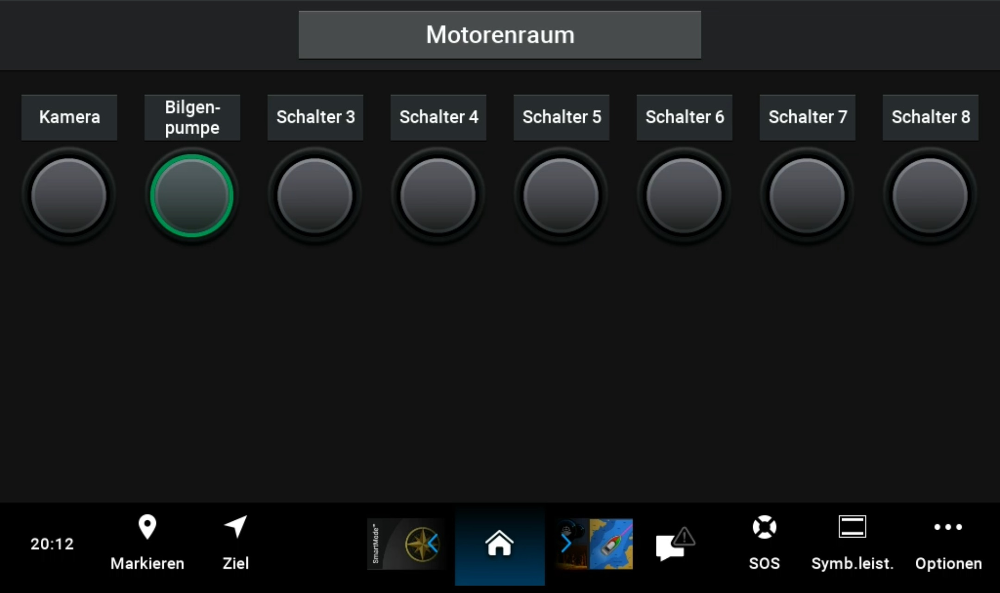

## Overview

The NMEA2000-Relaybox is a flexible and robust device for controlling and monitoring relays over the NMEA2000 network. It is designed for seamless integration with marine electronics, enabling reliable management of electrical components on your vessel.
Relays can also be switched directly from the web interface by clicking the LED button. Additionally, an off-delay (drop-out time) can be configured for each relay, allowing it to automatically switch off after a specified period.

**Key Features:**
- Supports up to 8 relays per device (expandable across multiple devices)
- NMEA2000 CAN communication using the ESP32 CAN interface and an external MCP2562 transceiver
- Web-based configuration interface
- Compatible with plotters supporting PGN 127501 (Binary Switch Bank Status) and PGN 127502 (Switch Bank Control)
- Synchronizes system time from NMEA2000 PGN 126992 (GPS/GLONASS) or PGN 129029 (GNSS), at most every 10 minutes
- Displays sunrise and sunset for the current local date, calculated by `SunTimes` from system time and PGN 129029 coordinates. Greenwich/UTC is the default timezone. A valid GNSS fix received within the last 60 seconds is required; missing data and polar day/night are shown explicitly. Times assume a standard unobstructed horizon, not terrain or observer altitude.
- Power supply via NMEA2000 bus

## Important Hint

Although this project communicates using NMEA2000, neither the device nor its software is certified or officially approved as an NMEA2000 product. Full compliance with every detail of the NMEA2000 specification is not guaranteed. Connecting this device to an NMEA2000 network is your responsibility and at your own risk.

---

## Table of Contents

- [NMEA2000-Relaybox](#nmea2000-relaybox)
  - [Overview](#overview)
  - [Important Hint](#important-hint)
  - [Table of Contents](#table-of-contents)
  - [Other NMEA2000 Projects](#other-nmea2000-projects)
  - [Hardware](#hardware)
    - [ESP32\_Relay\_X2 Pinout](#esp32_relay_x2-pinout)
    - [ESP32\_Relay\_X8 Pinout](#esp32_relay_x8-pinout)
  - [Libraries](#libraries)
  - [Wiring Diagram](#wiring-diagram)
  - [Programming](#programming)
  - [Case and Enclosure](#case-and-enclosure)
  - [Configuration](#configuration)
    - [System Configuration](#system-configuration)
    - [NMEA Configuration](#nmea-configuration)
    - [Relay Configuration](#relay-configuration)
  - [Firmware Update](#firmware-update)
  - [Blink Codes](#blink-codes)
  - [Reset](#reset)
  - [Default Credentials](#default-credentials)
  - [Default IP Address](#default-ip-address)

---

## Other NMEA2000 Projects

In addition to the relay box, the following NMEA2000 projects are also available from the same author:
- [Fluid Level Sensor](https://github.com/minou65/NMEA2000-FluidLevel)
- [DS1820 Temperature Monitor](https://github.com/minou65/NMEA2000-DS1820)
- [BME280 Environmental Sensor](https://github.com/minou65/NMEA2000-BME280)
- [Battery Monitor](https://github.com/minou65/NMEA2000-BatteryMonitor)

---

## Hardware

This project uses either the ESP32_Relay_X2 or ESP32_Relay_X8 board as the base. The ESP32 CAN interface connects to the NMEA2000 bus through an external MCP2562 CAN transceiver (TX: GPIO 5, RX: GPIO 4). The MCP2562 is a transceiver, not a CAN controller. Power is supplied directly from the NMEA2000 bus. Each relay can switch up to 10A at 30V.

### ESP32_Relay_X2 Pinout
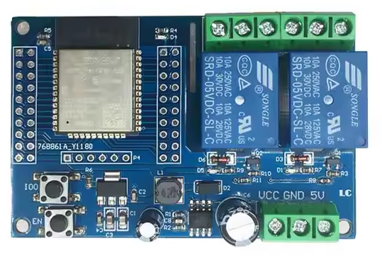

| GPIO | Output      |
|------|-------------|
| 16   | Relay 1     |
| 17   | Relay 2     |
| 23   | Internal LED|

### ESP32_Relay_X8 Pinout
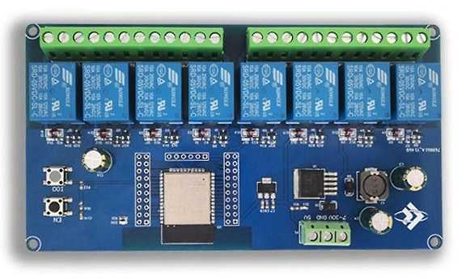

| GPIO | Output      |
|------|-------------|
| 32   | Relay 1     |
| 33   | Relay 2     |
| 25   | Relay 3     |
| 26   | Relay 4     |
| 27   | Relay 5     |
| 14   | Relay 6     |
| 12   | Relay 7     |
| 13   | Relay 8     |
| 23   | Internal LED|

---

## Libraries

The firmware uses the NMEA2000 and ESP32 NMEA2000 libraries, ESP Async WebServer and AsyncTCP, IotWebConf and its async extensions, IotWebRoot, EventLogger, and neotimer. PlatformIO searches the shared library folders configured in `platformio.ini` (`..\..\Libs\External`, `..\..\Libs\Private`, and `..\..\Libs\NMEA`). These libraries are not pinned to versions in this project, so make sure the shared folders are available when building.

---

## Wiring Diagram

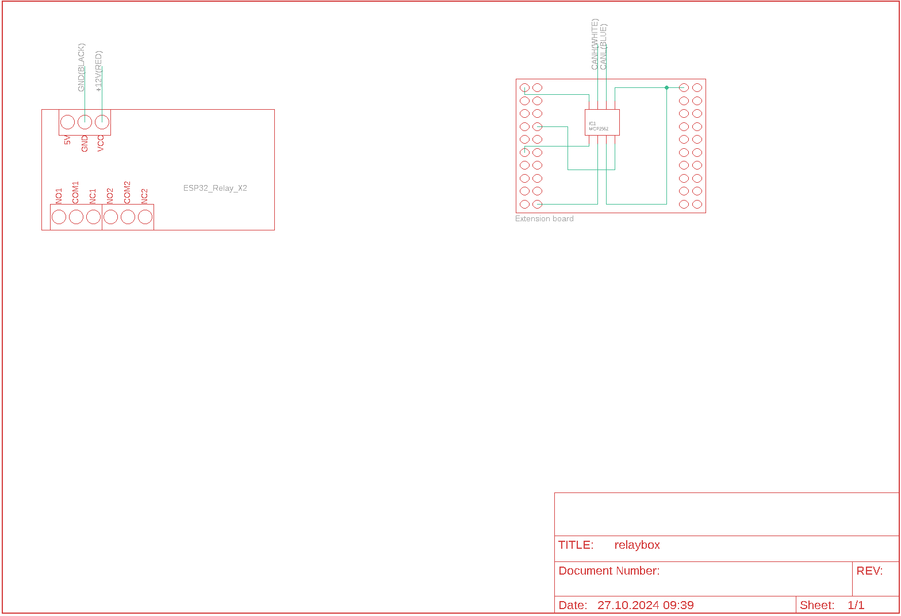

---

## Programming

Build and upload the firmware from the project root using the PlatformIO CLI (or the PlatformIO IDE extension). The configured environment is `wemos_d1_mini32`:

```sh
pio run -e wemos_d1_mini32
pio run -e wemos_d1_mini32 -t upload
```

Connect the board using its USB-to-serial interface or a compatible programmer such as the ESP-Prog. If PlatformIO does not detect the serial port automatically, specify it with `--upload-port` (for example, `--upload-port COM3`). The image below shows the pinout of the expansion header.

**Firmware Upload Procedure:**

1. Connect the ESP-Prog (or compatible programmer) to the expansion header as shown in the pinout diagram.
2. To enter programming mode:
  - Press and hold the I00 (GPIO0) button.
  - While holding I00, press the EN (Enable/Reset) button.
  - Release the EN button, then release the I00 button.
  - you will see the following in the Serial output
  ```cpp
  ets Jul 29 2019 12:21:46

rst:0x1 (POWERON_RESET),boot:0x3 (DOWNLOAD_BOOT(UART0/UART1/SDIO_REI_REO_V2))
waiting for download
  ```
3. Run the PlatformIO upload command above.
4. Once the upload is complete, press the EN button again to restart the device.

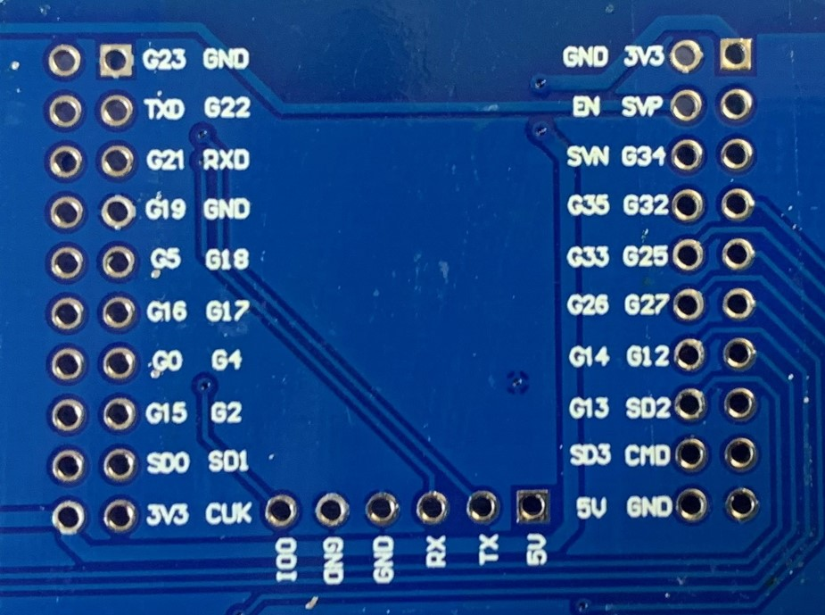

---

### Sun time tests

`SunTimes::setTimezone()` defaults to Greenwich (`UTC0`). To use Central European time, replace the startup call with `SunTimes::setTimezone("CET-1CEST,M3.5.0,M10.5.0/3")` and retain its error check. The setter configures the system-wide POSIX timezone and must be called before starting the web server. UTC system time and event timestamps remain unchanged; calculation uses the local calendar date, and the web interface labels times with the applicable timezone abbreviation (UTC, CET, or CEST).

From a Visual Studio Developer Command Prompt at the project root:

```bat
cl /nologo /std:c++14 /EHsc /W4 /Fo.pio\build\ /Fe.pio\build\SunTimesTests.exe tests\SunTimesTests.cpp src\SunTimes.cpp
.pio\build\SunTimesTests.exe
```

The native tests check published sunrise/sunset times (within two minutes), local date rollover, timezone formatting, invalid coordinates, and polar day/night. POSIX builds also check the exact CET/CEST transitions; Windows CRT does not implement the POSIX transition rules, so those cases are skipped there. The firmware build remains `pio run`.

## Case and Enclosure

STL files for 3D printing the case and lid are available in the `stl` folder.

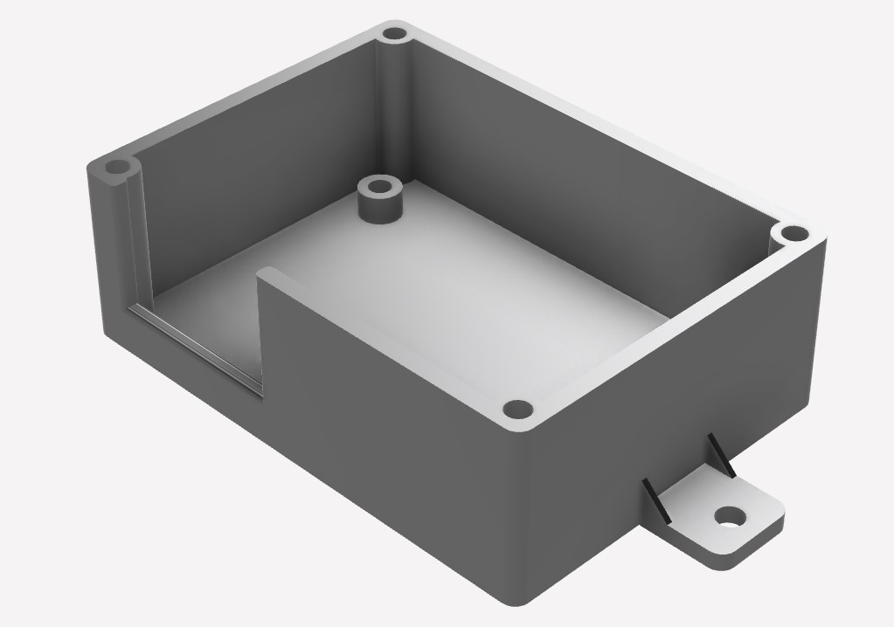 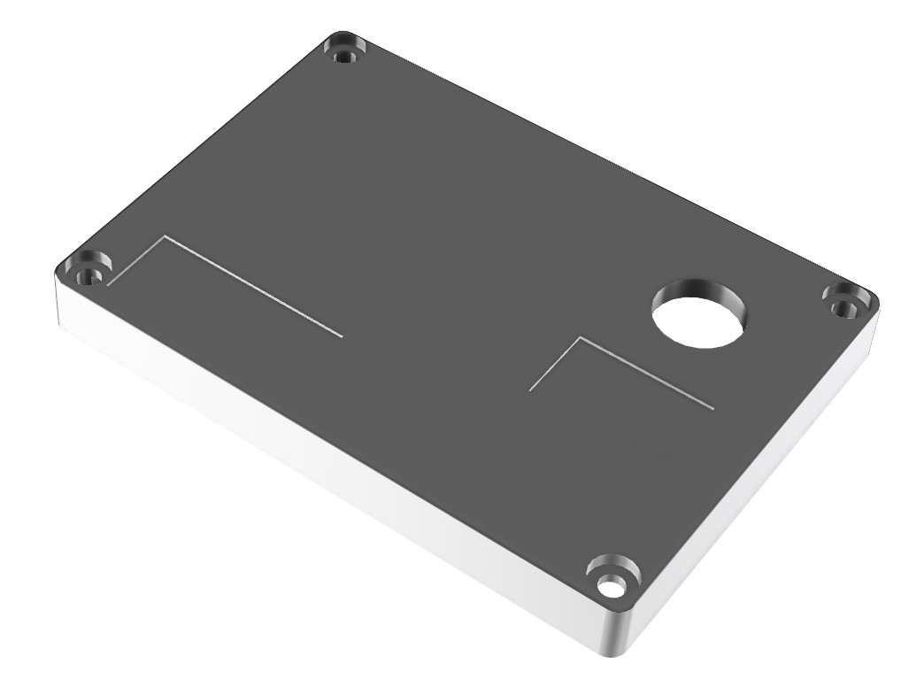
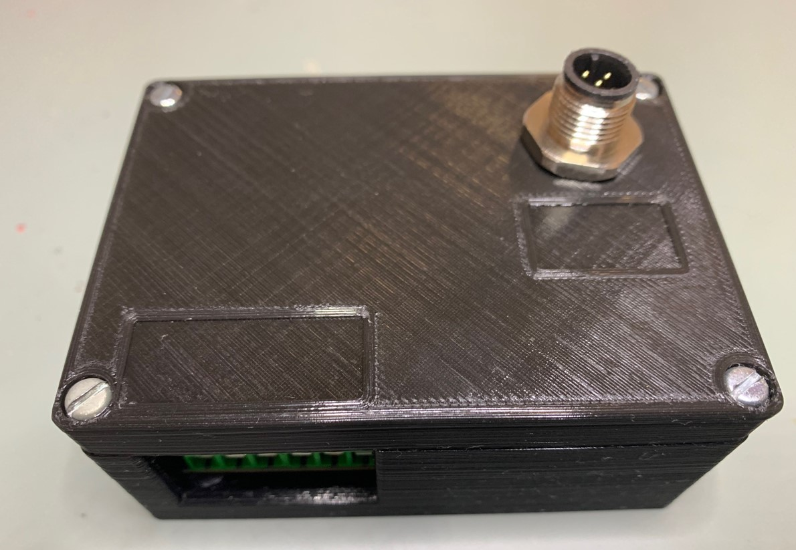 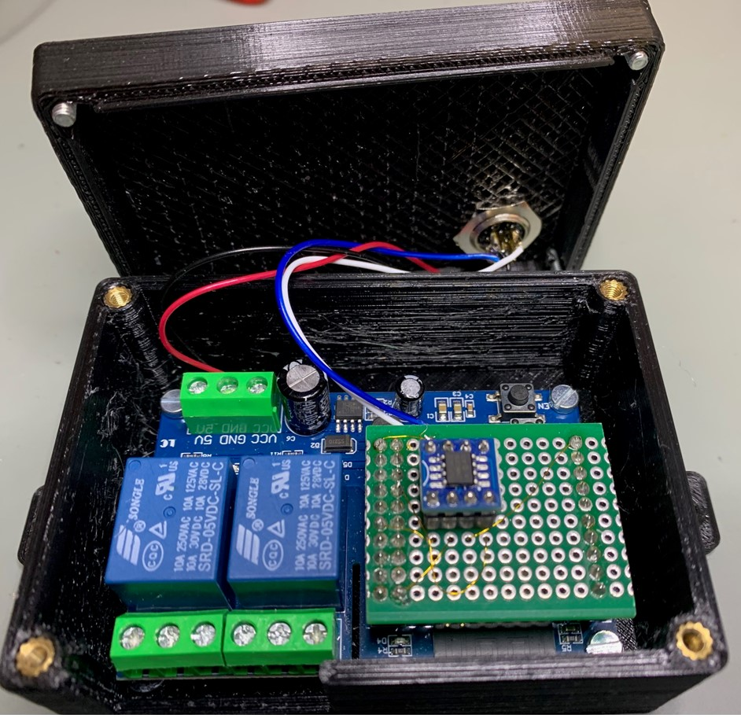

---

## Configuration

After the first boot, some values must be configured. Items marked with * are mandatory.

### System Configuration

- **Thing Name**: Assign a unique, descriptive name to the device (e.g., `relays_engine_room`). Use only English letters and underscores.
- **AP Password**: Set a secure password (8–32 characters, at least 12 recommended, with 3 character classes).*
- **WiFi SSID**: Name of the WiFi network to connect to.*
- **WiFi Password**: Password for the WiFi network above.*
- **AP Offline Mode (minutes)**: Set how long the AP should remain enabled after startup (0 = always enabled, up to 30 minutes).

### NMEA Configuration

- **Instance**: Should be unique for each device sending this PGN.*
- **SID**: Sequence identifier (usually 255).
- **Switch Bank Address**: Unique identifier for each device on the NMEA2000 network (up to 254 devices).

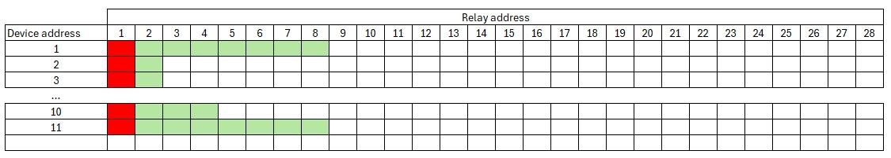

- **Relay Address**: Identifies which relay is controlled. Each switch bank can control up to 28 relays. Normally, the relay address is 1. If you use multiple relay boxes in one switch bank, set the correct relay address accordingly.

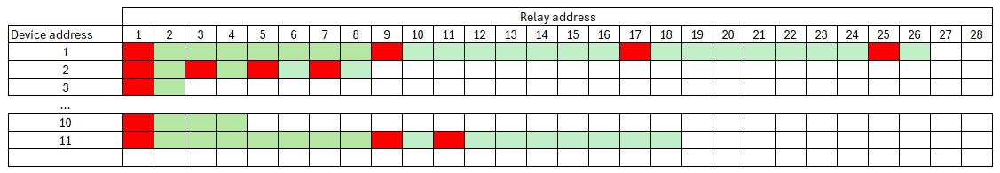

### Relay Configuration

- **GPIO**: The GPIO pin used for the relay.
- **Off Time (s)**: Time in seconds before the relay switches off automatically. If set to 0 (default), the relay remains on indefinitely.

---

## Firmware Update

To update the firmware, open the Configuration page in the web interface and click on the Firmware Update link. Follow the on-screen instructions.

---

## Blink Codes

| Blinking Pattern | Meaning |
|------------------|---------|
| Rapid blinking (mostly on, short off) | Access Point mode: device creates its own WiFi network. |
| Alternating on/off blinking | Connecting to configured WiFi network. |
| Mostly off, short flash | Device is online. |
| Mostly off, long flash | Device is in offline mode. |

---

## Reset

To reset the device, pull the CONFIG_PIN (GPIO 19) to ground during startup. The device will use the initial password to build an AP (useful if the password is lost).

---

## Default Credentials

- **Username:** admin
- **Initial AP password:** `123456789` (the configured password may differ after setup)

## Default IP Address

When in AP mode, the default IP address is `192.168.4.1`.

---

